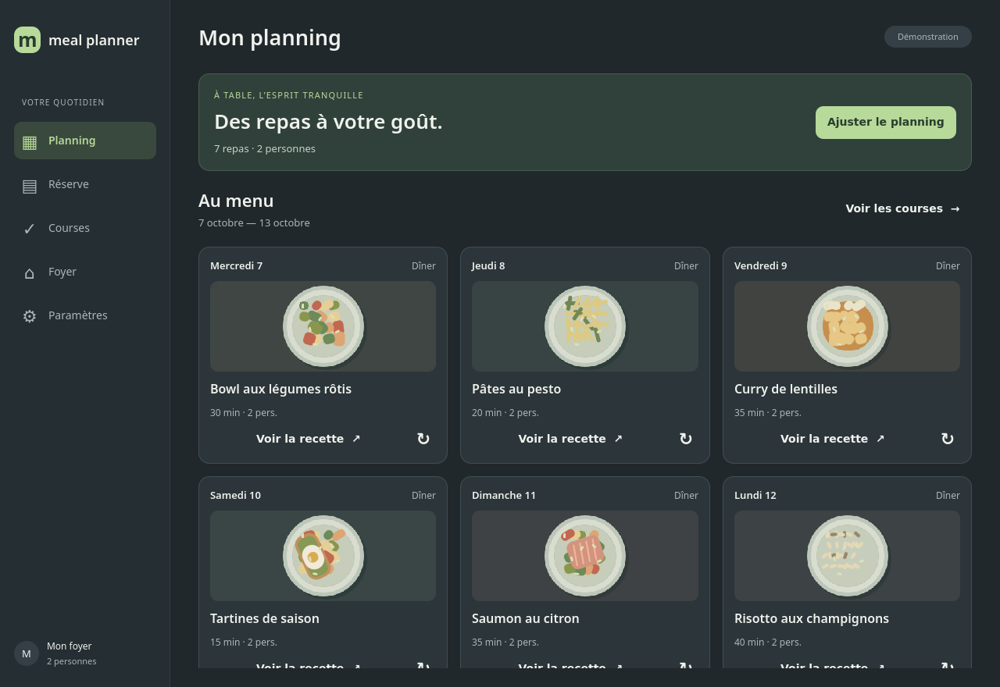

# Meal Planner AI

---

Meal Planner AI helps households plan meals and prepare grocery lists.
Add pantry items to track food already available at home.
Set the planning period and household size for your meals.
Record guests and dietary preferences for the household.
Ask the assistant to create meals and recipes from a written request.
Review recipes and see which ingredients are available or need buying.
Add grocery purchases and check them off while shopping.
Household settings, recipes, and grocery purchases are stored locally.
The desktop interface is available in English and French.
AI meal planning uses a GLM API key saved in Settings.

---

## See Meal Planner AI in action



---

## Quickstart

### Install

Install [uv](https://docs.astral.sh/uv/getting-started/installation/), then run from the project directory:

```bash
uv sync --locked
```

### Run

```bash
uv run meal-planner-ai
```

The app requires Python 3.12 and a graphical desktop with Qt platform libraries.
Add your GLM API key in Settings to use AI meal planning.
